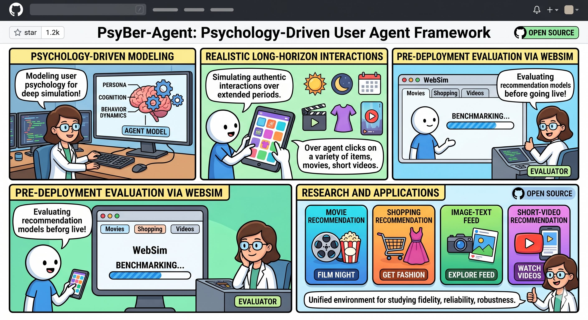

# PsyBer-Agent: A Psychological Behavior-Driven User Agent



PsyBer-Agent is a psychology-driven user agent framework for recommender systems. By modeling role, cognition, and behavioral dynamics, it simulates realistic, long-duration user interactions, and supports pre-deployment evaluation via WebSim, a lightweight interactive recommendation benchmark simulation platform. The project provides a unified environment for studying user behavior fidelity, the reliability of online A/B testing, model evaluation, and robustness across multiple recommendation scenarios, including movie, shopping, image-text, and short-video recommendation.

## Environment Setup

1. Create the `psyber` environment as follows (can be copied directly):

```bash
# 1) Create and activate the environment
conda create -y -n psyber python=3.11 pip
conda activate psyber

# 2) Install dependencies
pip install -U pip
pip install -r requirements.txt

# 3) Install the Playwright browser (for WebSim_agent)
playwright install chromium
```

Verification commands:

```bash
python src/prelearning_agent.py --help
python src/alignment_pretrain_agent.py --help
python src/WebSim_agent.py --help
python app.py
```

If you modify the environment later, you can re-export it with:

```bash
conda run -n psyber pip freeze | LC_ALL=C sort > /Users/chongzhang/PsyBer-Agent/requirements.txt
```

## Experimental Platform Setup

The WebSim platform is required here: [https://github.com/franz-chang/Web_simulation.git](https://github.com/franz-chang/Web_simulation.git "Platform Setup")

```bash
git clone https://github.com/franz-chang/Web_simulation.git
cd /Users/chongzhang/WebSim
python3 -m venv .venv
source .venv/bin/activate
pip install -U pip
pip install -r requirements.txt
```

Current dependencies in `requirements.txt`:

- `flask==3.0.2`
- `torch>=2.6.0`
- `pandas>=2.2.0`
- `numpy>=1.26.0`

## Functional Structure

- Reads task settings from `~/PsyBer-Agent/settings/task.yaml`: `dataset`, `model`, `track`, `agent_num` (also compatible with `Settings/task.yaml`)
- Ensures the service is running at `http://127.0.0.1:19002/` via `~/WebSim/run_service.sh`
- After opening the web page, it automatically:
  - Selects the dataset and model
  - Clicks "Random Reset"
  - Takes a screenshot of the current page, letting the Agent decide which item to click (or clicks "Next Page" when not interested)
- Continuously records the click sequence into the Agent memory, and closes the browser once `track` is reached (the track value is configurable)
- Newly added offline alignment pre-training stage: `src/alignment_pretrain_agent.py` reconstructs implicit trajectories from `ratings.dat`, performs OT alignment training, and outputs an online fast policy model `fast_inference_policy.pt` (by default saved to `PsyBer-Agent/outputs/fast_policies/{ml1m|amazon_mi}/fast_inference_policy.pt`)
- The online stage prioritizes fast policy inference (5-action parallel evaluation + Pareto filtering + lightweight policy sampling); ultimately, a Prompt summarizes the above results and lets the LLM make the final decision

## Pre-training Stage

Offline pre-processing pipeline (recommended order):

```bash
cd /Users/chongzhang/PsyBer-Agent
./Script/01_run_prelearning_agent.sh         # Data pre-processing
./Script/02_run_alignment_pretrain_agent.sh  # Psychology-behavior alignment
```

Note: `02_run_alignment_pretrain_agent.sh` enables `softlabel_ugw` by default, i.e., it first trains a regression prior to generate the initial UGW alignment, and then uses structural alignment to generate action soft labels for supervised training.

## Online Simulated User Stage

```bash
/PsyBer-Agent/src/WebSim_agent.py       # User simulation Agent
```

Optional parameters:

- `--headless`: Run without a UI
- `--skip-probability 0.2`: Probability of "not interested -> Next Page"
- `--seed 42`: Random seed
- `--track-override 10`: Temporarily override `track` for this run, convenient for quick testing
- `--close-service-when-done`: If the service was started by the Agent for this run, automatically shut it down when finished
- `--disable-fast-inference`: Disable fast policy inference, forcing the pure LLM-driven decision path
- `--fast-policy-path <path>`: Specify the fast policy model file (by default, automatically located according to the dataset path)
- `--fast-policy-stochastic`: The fast policy samples actions probabilistically (greedy by default)
- `--ablation-wo-template-random-selection`: Reserved for ablation experiments; disables random template/candidate selection and switches to deterministic selection

## API Pool (High-Concurrency Recommendation)

To prevent all Agents from crowding onto the same API under high concurrency, the project supports an **API pool**:

- Configuration file path: `./PsyBer-Agent/settings/api_pool.yaml` (also compatible with `Settings/api_pool.yaml`)
- Before each task starts, an API slot (`api_id`) is acquired from the pool
- The API slot is automatically released when the task ends
- When no API is available in the pool, the task waits instead of competing for the same API

Example `api_pool.yaml` format:

```yaml
defaults:
  base_url: "https://dashscope.aliyuncs.com/compatible-mode/v1"
  qwen_model: "qwen3-vl-flash"

apis:
  - id: "api-001"
    api_key: "sk-xxxx"
    enabled: true
  - id: "api-002"
    api_key: "sk-yyyy"
    enabled: true
    capacity: 1
```

Notes:

- When running at high concurrency (user scale greater than 1k), `api_pool.yaml` will be read
- If the pool file is missing or no API is available, the script fails directly (to avoid falling back to a single API and causing denial of service)
- `capacity` defaults to `1`, meaning a single API is occupied by at most 1 task at a time
- You can prepare about 200 `apis` entries to support large-scale concurrency

## Result Output

Each run generates:

- `./PsyBer-Agent/runs/<timestamp>/memory.json`
- `./PsyBer-Agent/runs/<timestamp>/summary.txt`
- `./PsyBer-Agent/runs/<timestamp>/web_service.log` (only when the service was started by the Agent)
- `summary.txt` additionally records `api_id` (when the task was assigned from the API pool).

## task.yaml Description

If `./PsyBer-Agent/settings/task.yaml` does not exist, the Agent will automatically create a default configuration (also compatible with `Settings/task.yaml`):

```yaml
dataset:
  - MovieLens-1M
  # - Amazon All Beauty
  # - Amazon Magazine Subscriptions
model:
  # - LightGCN
  # - PopRec
  # - BPR-MF
  # - GRU4Rec
  - BERT4Rec
  # - SASRec
  # - Mult-VAE
track: 30
agent_num: 200
```

You can determine the specific experimental tasks by uncommenting your choices. For the specific supported datasets and models, refer to the [WebSim experimental platform](https://github.com/franz-chang/Web_simulation.git "Platform Setup").
